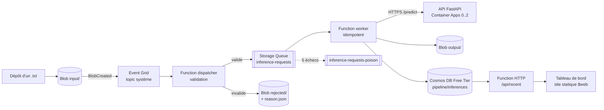
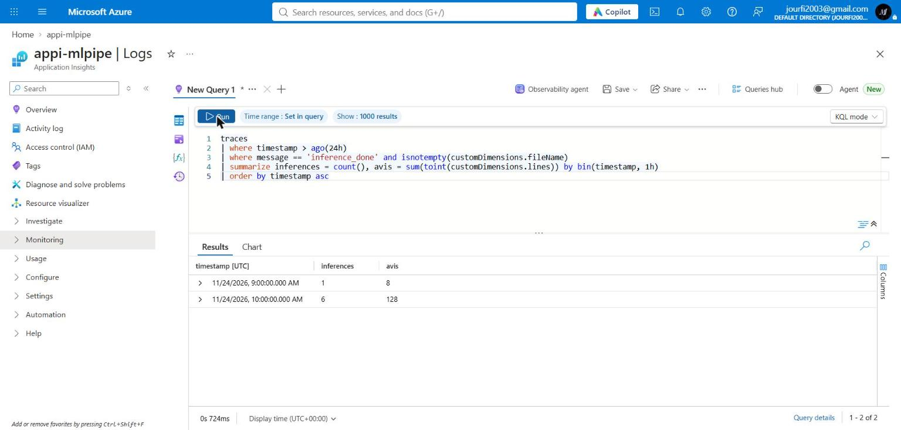
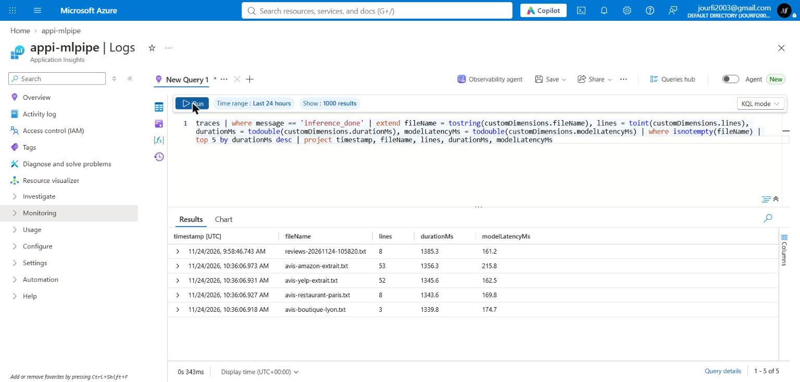
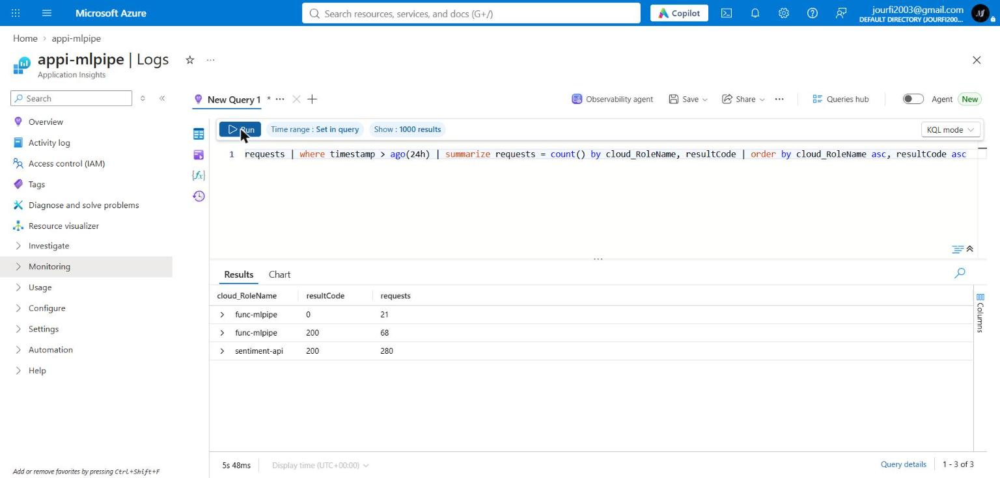
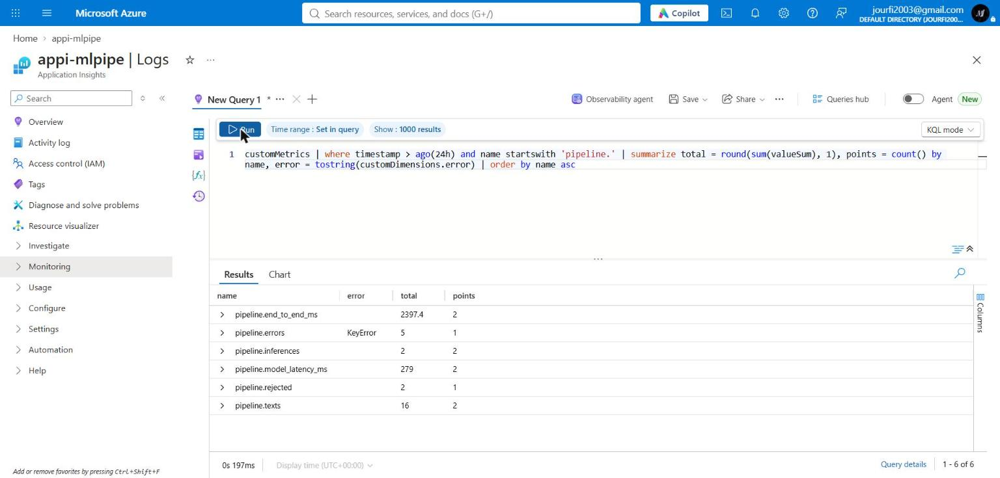
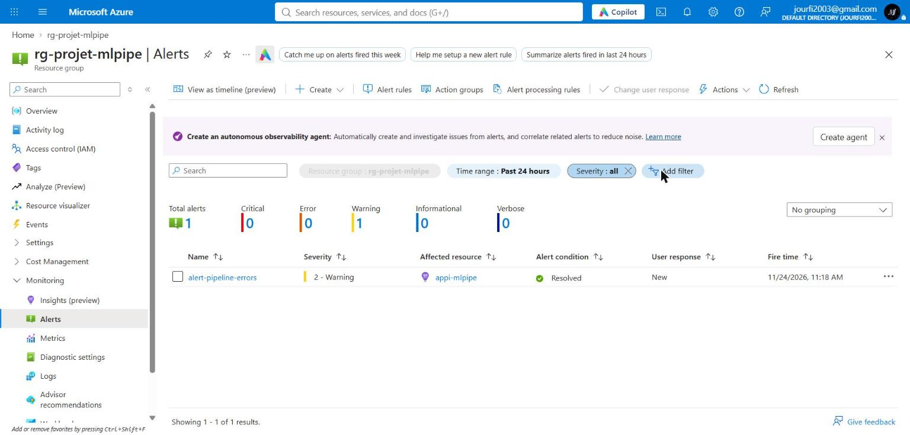
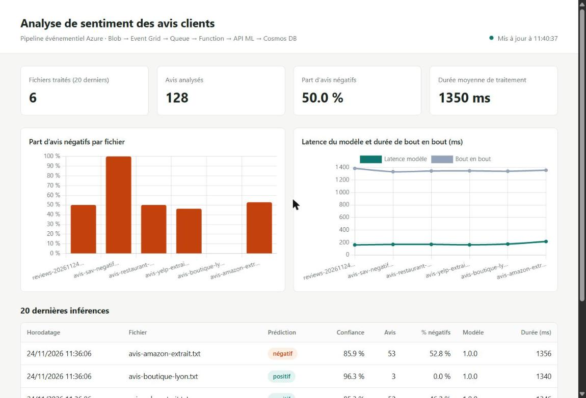
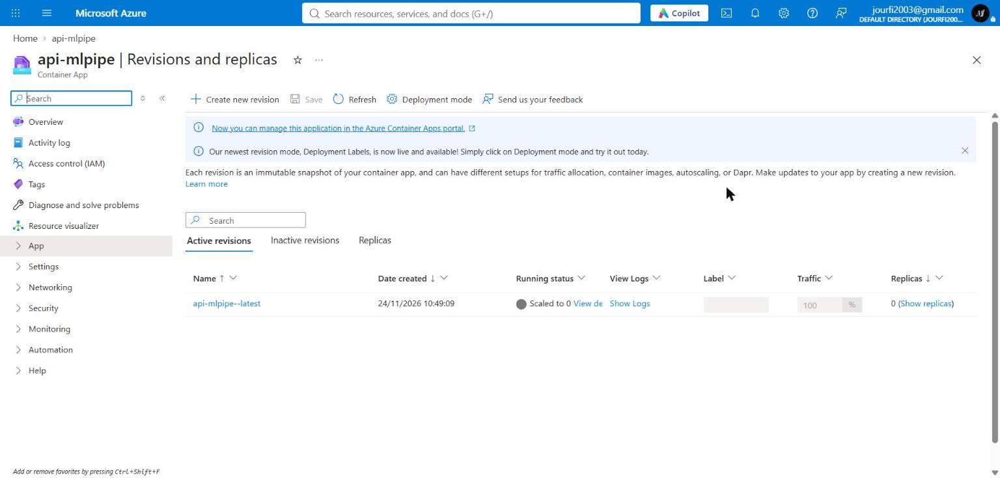
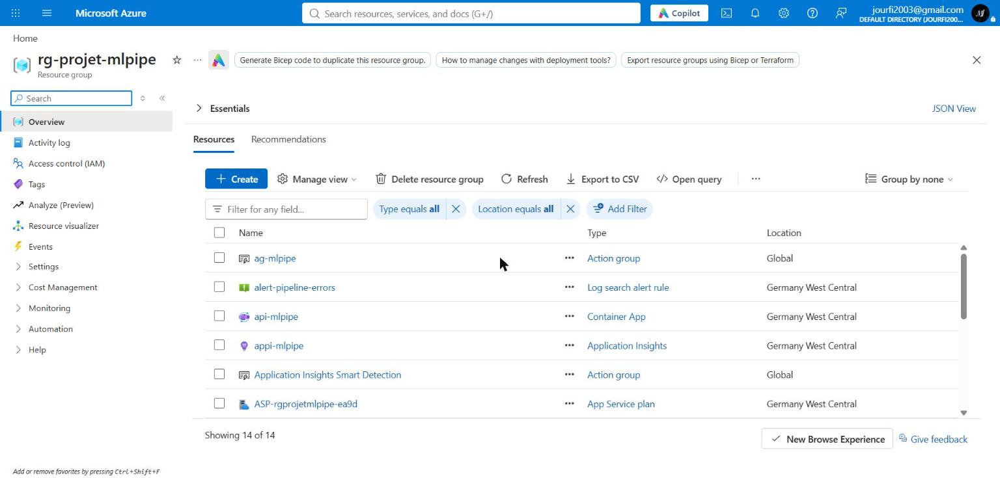

# Pipeline de Machine Learning événementiel sur Azure – avis clients

Projet de synthèse **Systèmes distribués et IA** (ECE Paris 2026–2027), réalisé sur un abonnement **Azure for Students**.

Un fichier texte d’avis clients (un avis par ligne) déposé dans `input/` passe par plusieurs étapes. Il est **validé**, mis en **file d’attente**, puis envoyé à une **API de ML conteneurisée** qui calcule le sentiment de chaque ligne. Le résultat est stocké dans `output/` et **Cosmos DB**, puis affiché dans un **tableau de bord** actualisé toutes les 30 s. Le tout est supervisé (Application Insights) et déployé depuis GitHub par OIDC, sans aucun secret.

## Sommaire
1. [Architecture](#1-architecture)
2. [Pile technique et dépendances](#2-pile-technique-et-dépendances)
3. [Jeu de données et modèle](#3-jeu-de-données-et-modèle)
4. [Structure du dépôt](#4-structure-du-dépôt)
5. [Développement local](#5-développement-local)
6. [Déploiement pas à pas](#6-déploiement-pas-à-pas)
7. [Exemples : appel curl, événement Event Grid, message de file](#7-exemples)
8. [Fiabilité : reprises, file poison, idempotence](#8-fiabilité)
9. [Observabilité : métriques, alerte, KQL](#9-observabilité)
10. [CI/CD et sécurité](#10-cicd-et-sécurité)
11. [Région, coûts et nettoyage](#11-région-coûts-et-nettoyage)
12. [Restrictions Azure for Students rencontrées](#12-restrictions-azure-for-students-rencontrées-et-solutions)

---

## 1. Architecture



Transverse : Application Insights (OpenTelemetry) + Log Analytics plafonné, GitHub Actions (OIDC), identités managées, budget et alertes.

| # | Service | Ressource | Rôle |
|---|---|---|---|
| 1 | Blob Storage (Standard LRS, chaud, versionnage) | `st<equipe>pipe` | `input/`, `output/`, `rejected/`, `models/`, `$web` |
| 2 | Event Grid + Function *dispatcher* | abonnement `blob-to-dispatcher` | `BlobCreated` filtré sur `input/` → validation → file ou `rejected/` |
| 3 | Storage Queue | `inference-requests` (+ `-poison`) | découplage, 5 tentatives |
| 4 | Function *worker* | `func-<equipe>` (Flex Consumption, Python 3.12, 512 Mo) | appel de l’API, écriture du résultat, métriques |
| 5 | API ML | `api-<equipe>` (Container Apps, 0,25 vCPU / 0,5 Gio, 0 à 2 réplicas) | `/health`, `/version`, `/predict`, `/metrics` |
| 6 | Blob `output/` | | JSON complet de chaque inférence |
| 7 | Cosmos DB for NoSQL Free Tier | `cosmos-<equipe>` / `pipeline` (400 RU/s) / `inferences` (clé `/fileName`) | métadonnées |
| 8 | Tableau de bord | `$web` + Function `recent` | tableau + 2 graphiques Chart.js |

Les trois fonctions (`dispatcher`, `worker`, `recent`) sont regroupées dans **une seule Function App** (modèle de programmation v2, `functions/function_app.py`).

## 2. Pile technique et dépendances

| Couche | Technologie | Version |
|---|---|---|
| Langage | Python | 3.12 (Azure, Docker, CI) |
| ML | scikit-learn (TF-IDF + LogisticRegression), numpy, scipy, joblib | 1.6.1 / 2.2.1 / 1.15.0 / 1.4.2 |
| API | FastAPI, Pydantic v2, Uvicorn | 0.115.6 / 2.10.4 / 0.34.0 |
| Serverless | Azure Functions (Flex Consumption, modèle v2), `azure-functions` | 1.21.3 |
| SDK Azure | `azure-identity`, `azure-storage-blob`, `azure-cosmos` | 1.19.0 / 12.24.0 / 4.9.0 |
| Client HTTP | httpx (client réutilisé, délai d’expiration) | 0.28.1 |
| Observabilité | `azure-monitor-opentelemetry` (distribution Azure Monitor OpenTelemetry) | 1.6.4 |
| Conteneur | Docker multi-étapes `python:3.12-slim`, utilisateur non root, HEALTHCHECK | – |
| Registre | GitHub Container Registry (`ghcr.io`) | – |
| Front | HTML/CSS/JS sans framework, Chart.js | 4.4.7 (CDN) |
| CI/CD | GitHub Actions : `ruff`, `pytest`, `docker/build-push-action`, `azure/login@v2` (OIDC), `Azure/functions-action@v1` | ruff 0.8.6, pytest 8.3.4 |
| IaC | Scripts Azure CLI commentés (`infra/*.sh`) | Azure CLI ≥ 2.60 |

Fichiers de dépendances figés : `model/requirements.txt`, `api/requirements.txt`, `api/requirements-dev.txt`, `functions/requirements.txt`.

## 3. Jeu de données et modèle

- **Jeu de données** : *Sentiment Labelled Sentences* (UCI ML Repository, n° 331, Kotzias et al., KDD 2015), **licence CC BY 4.0**. Il contient 3 000 phrases tirées d’avis Amazon, Yelp et IMDb, étiquetées 0 (négatif) ou 1 (positif), soit environ 200 Ko. Il est téléchargé automatiquement par `model/train.py`.
- **Tâche** : classification binaire du sentiment, une prédiction par ligne du fichier déposé.
- **Modèle** : union de TF-IDF (mots 1–2 grammes et caractères 2–5 grammes) suivie d’une régression logistique (`C=4`).
- **Protocole** : jeu de test séparé de 20 % (stratifié), graine 42, dépendances figées.

| Métrique (jeu de test, n = 600) | Modèle **1.0.0** | Référence naïve (classe majoritaire) |
|---|---|---|
| Accuracy | **0,860** | 0,500 |
| F1 (classe positive) | **0,862** | 0,000 |
| ROC AUC | **0,924** | 0,500 |

- Artefact : `model/model-1.0.0.joblib` (1,1 Mo), version sémantique **1.0.0**. Les métriques sont dans `model/metrics.json`.
- Inférence : **46 ms pour 500 lignes** sur CPU, soit bien moins que la limite de 1 s.

Ré-entraîner : `cd model && pip install -r requirements.txt && python train.py`

## 4. Structure du dépôt

```
model/        train.py, requirements.txt, model-1.0.0.joblib, metrics.json
api/          app/ (FastAPI), tests/ (pytest), Dockerfile multi-étapes, requirements*.txt
functions/    function_app.py (dispatcher, worker, recent), pipeline/ (validation, clients), host.json, tests/
web/          index.html, app.js, style.css, config.js (généré au déploiement)
infra/        config.sh, 00-check-region.sh, 01-setup.sh, 02-roles.sh, 03-eventgrid.sh, demo.sh, 99-cleanup.sh
samples/      fichiers de démonstration valides et invalides
loadtest/     burst.sh (rafale de fichiers), locustfile.py, analysis.kql (bonus test de charge)
.github/workflows/  ci.yml, deploy.yml
docs/         kql-queries.kql, cost-report.md, time-log.md, demo-script.md, screenshots/
```

## 5. Développement local

Aucun coût et aucun quota : Docker, Azure Functions Core Tools et Azurite suffisent.

```bash
python -m venv .venv && source .venv/bin/activate        # Windows : .venv\Scripts\activate
pip install -r api/requirements-dev.txt -r functions/requirements.txt
ruff check . && pytest                                    # 24 tests (API + validation)

# API dans Docker
docker build -f api/Dockerfile -t sentiment-api .
docker run --rm -p 8000:8000 sentiment-api
curl localhost:8000/health

# Functions + Azurite (émulateur de stockage)
npx azurite --silent --location .azurite &
cp functions/local.settings.example.json functions/local.settings.json
cd functions && func start
# tableau de bord : ouvrir web/index.html (config.js pointe sur http://localhost:7071)
```

En local, `STORAGE=UseDevelopmentStorage=true` remplace les connexions par identité, et Cosmos DB est ignoré si `COSMOS_ENDPOINT` est vide.

## 6. Déploiement pas à pas

Toutes les commandes sont lancées dans **l’abonnement d’intégration**, par son propriétaire (Cloud Shell ou Azure CLI ≥ 2.60). Les autres membres ne déploient que via GitHub Actions.

1. **Dépôt GitHub public** : poussez ce code. La CI construit l’image `ghcr.io/<compte>/<depot>/api:1.0.0`.
   Rendez ensuite le paquet public : *GitHub > Packages > api > Package settings > Change visibility > Public*. Container Apps pourra ainsi récupérer l’image sans identifiants.
2. **Configuration** : renseignez `EQ`, `LOC`, `GH_REPO` et `ALERT_EMAIL` dans `infra/config.sh`.
3. **Région** : `bash infra/00-check-region.sh`. Choisissez une région présente dans les deux listes (voir section 11).
4. **Plateforme** : `bash infra/01-setup.sh`. Le script crée le groupe étiqueté, Cosmos DB en premier, le stockage, Log Analytics (0,2 Go/jour), Application Insights, Container Apps, la Function App Flex, l’identité GitHub, l’alerte et le budget.
5. **Rôles** (une seule fois, par le propriétaire) : `bash infra/02-roles.sh`. Le script affiche les valeurs à saisir dans GitHub.
6. **GitHub** :
   - *Settings > Secrets > Actions* : `AZURE_CLIENT_ID`, `AZURE_TENANT_ID`, `AZURE_SUBSCRIPTION_ID`. Ce sont des identifiants non sensibles.
   - *Settings > Variables* : `AZURE_RG`, `CONTAINERAPP_NAME`, `FUNCAPP_NAME`, `STORAGE_ACCOUNT`.
   - *Settings > Environments* : créez `production` avec un **relecteur obligatoire**.
7. **Premier déploiement** : un push sur `main` lance la CI, puis *Deploy*. Après approbation, le workflow met à jour l’API, publie les Functions et le tableau de bord, puis lance un test de fumée.
8. **Event Grid** (une fois le *dispatcher* déployé) : `bash infra/03-eventgrid.sh`.
9. **Vérification** : `bash infra/demo.sh valid`, puis ouvrez l’URL `$web` affichée par `01-setup.sh`.

## 7. Exemples

**Appel de l’API**
```bash
curl -s -X POST https://api-<equipe>.<id>.<region>.azurecontainerapps.io/predict \
  -H "Content-Type: application/json" \
  -d '{"texts": ["Great phone, I love it!", "Terrible service, never again."]}'
```
```json
{"model_version":"1.0.0","count":2,"latency_ms":3.1,
 "predictions":[{"label":"positive","score":0.93,"positive_proba":0.93},
                {"label":"negative","score":0.91,"positive_proba":0.09}]}
```
`GET /version` renvoie `{"api_version":"1.0.0","model_version":"1.0.0","git_sha":"<commit>"}`.

**Événement Event Grid reçu par le *dispatcher***
```json
{
  "topic": "/subscriptions/<sub>/resourceGroups/rg-projet-<equipe>/providers/Microsoft.Storage/storageAccounts/st<equipe>pipe",
  "subject": "/blobServices/default/containers/input/blobs/reviews-20261124-101500.txt",
  "eventType": "Microsoft.Storage.BlobCreated",
  "eventTime": "2026-11-24T10:15:00.123Z",
  "id": "…",
  "data": {
    "api": "PutBlob", "contentType": "text/plain", "contentLength": 382,
    "blobType": "BlockBlob", "eTag": "0x8DD0C4A1B2C3D4E",
    "url": "https://st<equipe>pipe.blob.core.windows.net/input/reviews-20261124-101500.txt"
  },
  "dataVersion": "", "metadataVersion": "1"
}
```

**Message déposé dans `inference-requests`**
```json
{"blobName": "reviews-20261124-101500.txt", "eTag": "0x8DD0C4A1B2C3D4E", "size": 382, "eventTime": "2026-11-24 10:15:00.123000+00:00"}
```

**Document Cosmos DB** (`pipeline/inferences`, partition `/fileName`)
```json
{"id": "3f9a…", "fileName": "reviews-20261124-101500.txt", "day": "2026-11-24",
 "timestamp": "2026-11-24T10:15:04.512Z", "prediction": "negative", "confidence": 0.87,
 "negativeShare": 0.5, "count": 8, "modelVersion": "1.0.0", "durationMs": 412.3,
 "modelLatencyMs": 180.4, "outputBlob": "output/reviews-20261124-101500.json"}
```

## 8. Fiabilité

| Mécanisme | Mise en œuvre |
|---|---|
| Validation | Le *dispatcher* vérifie l’extension (`.txt`), la taille (≤ 1 Mo), l’encodage UTF-8 et le schéma (1 à 500 lignes non vides, ≤ 5 000 caractères chacune). En cas d’échec, il copie le fichier dans `rejected/` avec un fichier `<nom>.reason.json` qui donne le motif. |
| Découplage | Event Grid → file `inference-requests` → *worker*. Le traitement peut être lent ou en panne sans perte d’événement. |
| Reprises | `host.json` : `maxDequeueCount = 5` et `visibilityTimeout = 10 s`. Toute exception du *worker* rend le message de nouveau visible. |
| File poison (DLQ) | Après 5 échecs, le message part dans `inference-requests-poison`. |
| Idempotence | L’identifiant est `sha256(nom du blob + ETag)`. Si le document existe déjà, le message est ignoré. Sinon, le worker fait un **upsert** dans Cosmos DB et un écrasement dans `output/`. Un blob réécrit (ETag différent) est ignoré, car son propre événement le traitera. |
| Client HTTP | Un seul `httpx.Client` par processus, délai d’expiration de 45 s pour absorber le démarrage à froid de l’API (0 réplica). |

**Scénario d’échec documenté** (`bash infra/demo.sh poison`) : un message JSON malformé est déposé dans la file. Le *worker* lève `KeyError` à chacune des 5 tentatives (environ 10 s d’écart). Chaque échec incrémente la métrique `pipeline.errors`. Le message finit dans `inference-requests-poison`, ce qui déclenche l’alerte `alert-pipeline-errors` et l’envoi d’un e-mail.
Autre scénario : l’API est indisponible (`az containerapp update --image …:inexistante`). Les messages sont retentés puis envoyés dans la file poison. On les rejoue ensuite en les replaçant dans la file principale.

## 9. Observabilité

- **Log Analytics** `log-<equipe>` (plafond **0,2 Go/jour**) et **Application Insights** `appi-<equipe>` basé sur cet espace. Les deux sont créés explicitement dans le groupe du projet et reliés à la Function App (`--app-insights`) et à l’API (variable `APPLICATIONINSIGHTS_CONNECTION_STRING` stockée comme secret Container Apps).
- **OpenTelemetry** : `configure_azure_monitor()` dans l’API (instrumentation FastAPI automatique) et dans les Functions.
- **Métriques personnalisées** :

| Métrique | Type | Émise par |
|---|---|---|
| `pipeline.inferences` | compteur (fichiers traités) | worker |
| `pipeline.texts` | compteur (lignes traitées) | worker |
| `pipeline.model_latency_ms` | histogramme | worker |
| `pipeline.end_to_end_ms` | histogramme | worker |
| `pipeline.errors` | compteur (taux d’erreur) | worker |
| `pipeline.rejected` | compteur | dispatcher |
| `api.predictions`, `api.model_latency_ms` | compteur / histogramme | API |

- **Alerte** `alert-pipeline-errors` : alerte de journal évaluée toutes les 15 min sur `pipeline.errors > 0`. Elle notifie par e-mail via le groupe d’actions `ag-<equipe>` (quelques centimes par mois). Pour la déclencher volontairement : `bash infra/demo.sh poison`.
- **Requêtes KQL** (`docs/kql-queries.kql`) :

**Q1 – Inférences par heure**
```kusto
traces
| where timestamp > ago(24h)
| where message == "inference_done" and isnotempty(customDimensions.fileName)
| summarize inferences = count(), avis = sum(toint(customDimensions.lines)) by bin(timestamp, 1h)
| render columnchart
```
Résultat obtenu le 24/11/2026 (Application Insights `appi-mlpipe`) :

| timestamp (UTC) | inferences | avis |
|---|---|---|
| 2026-11-24 09:00 | 1 | 8 |
| 2026-11-24 10:00 | 6 | 128 |



**Q2 – 5 fichiers les plus lents**
```kusto
traces
| where message == "inference_done"
| extend fileName = tostring(customDimensions.fileName), durationMs = todouble(customDimensions.durationMs)
| where isnotempty(fileName)
| top 5 by durationMs desc
| project timestamp, fileName, durationMs
```
Résultat obtenu :

| timestamp (UTC) | fileName | lignes | durationMs | modelLatencyMs |
|---|---|---|---|---|
| 09:58:46 | reviews-20261124-105820.txt | 8 | 1385.3 | 161.2 (démarrage à froid de l’API) |
| 10:36:06 | avis-amazon-extrait.txt | 53 | 1356.3 | 215.8 |
| 10:36:06 | avis-yelp-extrait.txt | 52 | 1345.6 | 162.5 |
| 10:36:06 | avis-restaurant-paris.txt | 8 | 1343.6 | 169.8 |
| 10:36:06 | avis-boutique-lyon.txt | 3 | 1339.8 | 174.7 |



**Q3 – Répartition des codes HTTP**
```kusto
requests
| where timestamp > ago(24h)
| summarize count() by cloud_RoleName, resultCode
| render piechart
```
Résultat obtenu :

| cloud_RoleName | resultCode | requests |
|---|---|---|
| func-mlpipe | 0 | 21 (invocations file d’attente / Event Grid, sans code HTTP) |
| func-mlpipe | 200 | 68 |
| sentiment-api | 200 | 280 |





Erreurs du worker (Q3 bis) : `pipeline.errors` = 5 (`KeyError`, les 5 tentatives du message empoisonné), `pipeline.rejected` = 2.

**Alerte déclenchée** : `alert-pipeline-errors`, état *Fired*, sévérité 2, le 2026-11-24 à 10:18:32 UTC, suite au message empoisonné envoyé à 10:12 (`bash infra/demo.sh poison`), puis résolue automatiquement.



### Preuves des tests de bout en bout (24/11/2026)

| Scénario | Commande | Résultat observé |
|---|---|---|
| Dépôt valide | `bash infra/demo.sh valid` | `input/` à 10:58:20 → document Cosmos DB à 10:58:46 (**≈ 26 s**, démarrage à froid inclus), `output/reviews-….json` |
| Lot de 5 fichiers | `az storage blob upload-batch` | 5 résultats en moins d’une minute, 120 avis |
| Dépôt invalide | `bash infra/demo.sh invalid` | `rejected/bad-….csv` (*extension not allowed (expected .txt)*) et `rejected/empty-….txt` (*no non-blank line*), chacun avec `.reason.json` |
| Message empoisonné | `bash infra/demo.sh poison` | 5 tentatives (`KeyError`) puis `inference-requests-poison` en ≈ 1 min |
| Mise à l’échelle jusqu’à zéro | `az containerapp replica list` | 0 réplica après la période d’inactivité |
| Déploiement continu | push sur `main` → approbation → *Deploy* | `GET /version` renvoie le `git_sha` du commit déployé |







Autres captures : [workflows GitHub Actions](docs/screenshots/github-actions.jpg), [déploiement OIDC réussi](docs/screenshots/github-deploy-oidc.jpg), [budget 25 $](docs/screenshots/budget-25usd.jpg), [Cost analysis J0](docs/screenshots/cost-analysis-j0.jpg).

### Démonstration du 24/11/2026 à 16:16 (résultats attendus et obtenus)

| # | Action (16:16:58) | Résultat obtenu | Capture |
|---|---|---|---|
| 1 | Dépôt de `demo-avis-valides.txt` (8 avis) dans `input/` | Tableau de bord : **positif, 91,1 %, 8 avis, 50 % négatifs** (traité à 16:17:27, API réveillée depuis 0 réplica) | [demo-1](docs/screenshots/demo-1-tableau-de-bord.jpg) |
| 2 | – | `output/demo-avis-valides.json` : résumé + prédiction de chaque ligne | [demo-2](docs/screenshots/demo-2-resultat-output-json.jpg) |
| 3 | Dépôt de `demo-mauvaise-extension.csv` et `demo-fichier-vide.txt` | Copiés dans `rejected/` avec leur `.reason.json` | [demo-3](docs/screenshots/demo-3-conteneur-rejected.jpg) |
| 4 | – | Motif : *extension not allowed (expected .txt)* | [demo-4](docs/screenshots/demo-4-motif-de-rejet.jpg) |
| 5 | Message JSON invalide dans `inference-requests` | Après 5 tentatives, dans `inference-requests-poison` à 16:17:57 | [demo-5](docs/screenshots/demo-5-file-poison.jpg) |
| 6 | – | `pipeline.errors` = 10 (`KeyError`), `pipeline.rejected` = 6 | [demo-6](docs/screenshots/demo-6-metriques.jpg) |
| 7 | – | Alerte `alert-pipeline-errors` **Fired** à 16:18 | [demo-7](docs/screenshots/demo-7-alerte-fired.jpg) |

### Bonus : test de charge

[Rapport complet](docs/loadtest/README.md).

- **Rafale de 100 fichiers (5 000 avis) :**
  - 100/100 traités en ≈ 32 s, API au repos (0 réplica) au départ ;
  - 0 erreur, 0 doublon ;
  - Functions Flex : 21 instances pour le *dispatcher*, 8 pour le *worker*.
- **Locust, 20 utilisateurs pendant 60 s :**
  - 1 632 requêtes, 0 échec, ≈ 30 req/s ;
  - latence côté serveur p50 6 ms, p95 38 ms ;
  - Container Apps passe à 2 réplicas.
- **Goulot d’étranglement :** le démarrage à froid de l’API (≈ 15 s), compromis assumé pour garder un coût nul au repos.

## 10. CI/CD et sécurité

| Workflow | Déclencheur | Étapes |
|---|---|---|
| `ci.yml` | push, pull request | `ruff check` + `ruff format --check`, `pytest` (API), import des 3 fonctions + `pytest` (validation), construction de l’image. Sur un push, l’image est publiée sur GHCR avec les tags `1.0.0` et `<sha>`, et sa taille doit rester < 500 Mo. |
| `deploy.yml` | fin de la CI réussie sur un push dans `main` (ou `workflow_dispatch`) | Environnement `production` avec relecteur obligatoire. Connexion **OIDC** (`azure/login@v2`, identité managée attribuée par l’utilisateur). Puis `az containerapp update --image …:<sha>`, déploiement Functions Flex, publication de `$web` et test de fumée `GET /version == <sha>`. |

- **Aucun secret dans le dépôt**. Les secrets GitHub ne contiennent que des identifiants (`AZURE_CLIENT_ID`, `AZURE_TENANT_ID`, `AZURE_SUBSCRIPTION_ID`). GHCR utilise le `GITHUB_TOKEN` éphémère.
- **Connexions par identité** : la Function App utilise son identité attribuée par le système. Elle a les rôles *Storage Blob Data Owner* et *Storage Queue Data Contributor*, ainsi que *Cosmos DB Built-in Data Contributor* sur le plan de données. Aucune clé Cosmos ou chaîne de connexion n’apparaît dans le code.
- **Moindre privilège** : l’identité GitHub est *Contributor* sur **le seul groupe de ressources** et *Storage Blob Data Contributor* sur le compte de stockage (publication de `$web`). Elle ne peut pas créer d’attributions de rôles : celles-ci sont faites une seule fois par le propriétaire (`02-roles.sh`).
- **Image** : construction multi-étapes, **≈ 380 Mo** décompressée (117 Mo compressée), utilisateur non root (uid 10001), `HEALTHCHECK`, sondes *liveness* et *readiness* sur `/health`. La configuration passe uniquement par des variables d’environnement.
- **Dépôt privé** (alternative, section 4.6 du sujet) : utilisez le sujet fédéré `repo:<compte>/<depot>:ref:refs/heads/main` (commenté dans `01-setup.sh`), retirez `environment: production` de `deploy.yml` et déployez via `workflow_dispatch`.

## 11. Région, coûts et nettoyage

**Région choisie : `germanywestcentral`**.

- Régions autorisées par la stratégie *Allowed resource deployment regions* de l’abonnement : `spaincentral`, `denmarkeast`, `germanywestcentral`, `austriaeast`, `switzerlandnorth`.
- Parmi elles, Flex Consumption est disponible partout **sauf** `denmarkeast`.
- `germanywestcentral` a été retenue : c’est une région mature, et Cosmos DB Free Tier, Container Apps et la Function App Flex y ont été créés du premier coup, sans refus de capacité ni limitation 429.

URL publiques :
- API : `https://api-mlpipe.ashyflower-543a12e0.germanywestcentral.azurecontainerapps.io`
- Tableau de bord : `https://stmlpipepipe.z1.web.core.windows.net/`

| Poste | Estimation sur 15 jours |
|---|---|
| Functions Flex, Container Apps, Event Grid, Cosmos Free Tier, Log Analytics (< 5 Go) | 0 $ (offres gratuites) |
| Stockage | < 0,20 $ |
| Alerte de journal | < 0,50 $ |
| GHCR (au lieu d’ACR) | 0 $ |
| **Total** | **≈ 0 à 1 $** (enveloppe : 25 $) |

- Étiquettes `projet=dscc`, `equipe=<equipe>`. Budget de 25 $ avec alertes à 20, 50 et 80 % (`01-setup.sh`).
- Rapport détaillé : [`docs/cost-report.md`](docs/cost-report.md). Journal de temps : [`docs/time-log.md`](docs/time-log.md).
- **Après la soutenance** : `bash infra/99-cleanup.sh`, puis capture de `az group exists` (= `false`) et de `az group list -o table` (aucun `DefaultResourceGroup-*`).

## 12. Restrictions Azure for Students rencontrées et solutions

| Restriction | Symptôme | Solution appliquée |
|---|---|---|
| Régions imposées | `RequestDisallowedByPolicy` | Une seule région présente dans les deux listes (`00-check-region.sh`), toutes les ressources y sont créées. |
| Aucun droit Entra ID | `az ad sp create-for-rbac` refusé | Identité managée attribuée par l’utilisateur + informations d’identification fédérées (OIDC). `--assignee-object-id` partout. |
| ACR Tasks indisponible | `TasksOperationsNotAllowed` | Image construite dans GitHub Actions et publiée sur **GHCR** (gratuit). Pas d’ACR. |
| Static Web Apps hors région | « policy violation » | Tableau de bord hébergé dans le **site web statique Blob** (`$web`). |
| 1 seul environnement Container Apps | « cannot have more than 1 Container App Environments » | Un seul environnement `cae-<equipe>`. |
| Création du plan limitée | 429 « App Service Plan Create operation is throttled » | Attente puis nouvelle tentative. Si l’erreur persiste, autre région. Les scripts sont relançables. |
| Cosmos DB : régions EUAP seulement dans le portail | liste limitée / « high demand » | Compte créé **en CLI en premier** dans la région autorisée. Repli possible sur Table Storage. |
| Contributor ne peut pas attribuer de rôles | `AuthorizationFailed` sur `roleAssignments/write` | Attributions faites une fois par le propriétaire (`02-roles.sh`). |
| Required reviewers / environnements | `AADSTS700213` en dépôt privé | Dépôt **public** avec environnement `production` et relecteur obligatoire. |
| Crédit partagé de 100 $ | ressources désactivées si épuisé | Budget 25 $ + alertes, plafond Log Analytics, 0 réplica au repos, nettoyage scripté. |
| Tenant avec MFA obligatoire | `az login` : `AADSTS50076` puis « No subscriptions found » | `az login --tenant <id du tenant>` pour déclencher la MFA. Le *broker* Windows (WAM) étant annulé, connexion par navigateur (`core.enable_broker_on_windows=false`). |
| Sujet OIDC GitHub à identifiants immuables | `AADSTS700213` : le sujet présenté est `repo:kaiokasa@146456810/azure-ml-pipeline@1469889693:environment:production` | Deuxième information d’identification fédérée avec ce sujet exact. `01-setup.sh` l’enregistre désormais automatiquement via `gh api`. |
| Environnement Container Apps « express » | `ExpressRevisionSuffixNotSupported` sur `az containerapp update --revision-suffix` | Suffixe de révision retiré de `deploy.yml`. La version déployée est prouvée par `GET /version` (`git_sha`). |
| Flex Consumption : métriques perdues | Les traces `inference_done` arrivent mais pas `pipeline.inferences` (instance gelée avant l’export périodique de 60 s) | `force_flush()` du fournisseur de métriques à la fin de chaque exécution du *worker* et du rejet. Q1 basée sur les traces. |
| Git Bash (Windows) réécrit les arguments `/…` | `--partition-key-path /fileName`, `--scope /` transformés en chemins Windows | `MSYS_NO_PATHCONV=1` et fonction `winpath` dans `infra/config.sh`. |
