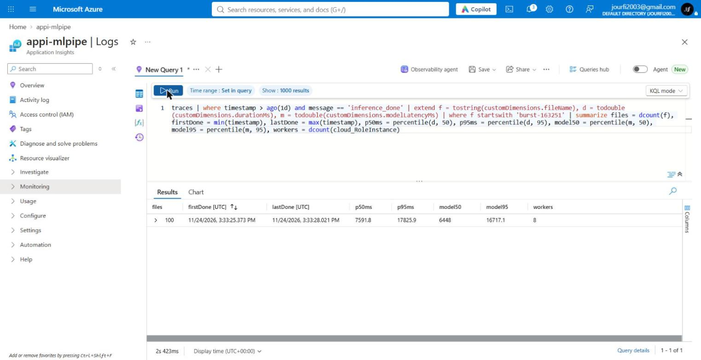
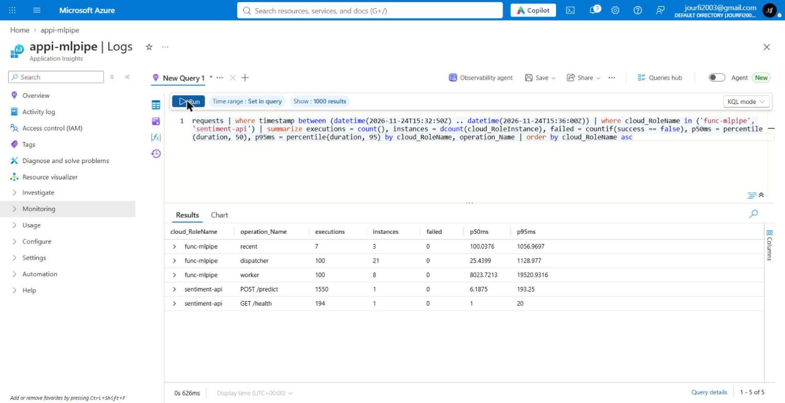

# Bonus – Test de charge (24/11/2026)

Deux tests courts, conformément au sujet (« quelques minutes suffisent ») :

1. **Rafale de 100 fichiers** déposés dans `input/` → pipeline complet (Event Grid → *dispatcher* → file → *worker* → API → Cosmos DB).
2. **Locust** sur l’API d’inférence seule : 20 utilisateurs pendant 60 s.

Scripts : [`loadtest/burst.sh`](../../loadtest/burst.sh), [`loadtest/locustfile.py`](../../loadtest/locustfile.py). Requêtes KQL : [`loadtest/analysis.kql`](../../loadtest/analysis.kql).

## 1. Rafale de 100 fichiers (pipeline complet)

```
bash loadtest/burst.sh 100        # run burst-163251
```

- 100 fichiers × 50 avis = **5 000 avis**, extraits du jeu de données UCI.
- État initial : API à **0 réplica** (démarrage à froid inclus dans la mesure).

| Indicateur | Valeur |
|---|---|
| Dépôt des 100 fichiers | 15:32:56 → 15:33:22 UTC (26 s, 16 connexions) |
| Fichiers traités | **100 / 100**, fin entre 15:33:25 et 15:33:28 UTC |
| Délai total | **≈ 32 s** après le premier dépôt, **≈ 6 s** après le dernier |
| Erreurs / doublons / rejets / file poison | **0 / 0 / 0 / 0** |
| Durée de traitement par fichier (worker) | p50 **7,6 s**, p95 **17,8 s**, max 18,0 s |
| Latence de l’appel `/predict` vue du worker | p50 **6,4 s**, p95 **16,7 s** |
| Instances Functions (Flex Consumption) | *dispatcher* : **21**, *worker* : **8** (100 exécutions chacun) |

**Analyse**

- **Mise à l’échelle des Functions.** Le plan Flex Consumption a ajouté des instances sans aucune configuration : 21 pour le *dispatcher* (déclenché par Event Grid) et 8 pour le *worker* (déclenché par la file). Le *worker* traite les messages par lots (`batchSize = 8`, `newBatchThreshold = 4` dans `host.json`).
- **Goulot d’étranglement : le démarrage à froid de l’API.** Container Apps est configuré à `min-replicas 0`. Les premiers appels attendent donc le démarrage du conteneur (≈ 15 s), ce qui explique le p95 de 17,8 s. Une fois l’API chaude, le modèle répond en quelques millisecondes (voir partie 2).
- **Fiabilité.** Aucun doublon malgré la livraison « au moins une fois » d’Event Grid (idempotence `sha256(nom + ETag)`), et aucune reprise nécessaire.
- **Compromis coût / latence.** `min-replicas 1` supprimerait le démarrage à froid, mais l’API serait facturée en permanence. Pour ce projet (budget 25 $), on garde 0 réplica : la rafale reste traitée en ≈ 30 s, sous l’objectif d’une minute.



## 2. Locust sur l’API (20 utilisateurs, 60 s)

```
locust -f loadtest/locustfile.py --host https://api-mlpipe.ashyflower-543a12e0.germanywestcentral.azurecontainerapps.io \
       --headless -u 20 -r 5 -t 60s --csv docs/loadtest/locust
```

Chaque appel `/predict` envoie 1 à 50 avis, avec un `/health` pour 10 prédictions.

| Indicateur | Côté client (Locust) | Côté serveur (Application Insights) |
|---|---|---|
| Requêtes | 1 623 | 1 632 |
| Échecs | **0 (0 %)** | **0** |
| Débit | **28,9 req/s** | ≈ 33 req/s en régime établi (324 à 378 req / 10 s) |
| Latence p50 | 210 ms | **6 ms** |
| Latence p95 | 1 100 ms | **38 ms** |
| Latence p99 | 2 200 ms | **173 ms** |
| Réplicas Container Apps | – | 2 en fin de test (règle HTTP : 20 requêtes simultanées), trafic servi par le 1er |

**Analyse**

- **Écart client / serveur.** Le modèle répond en 6 ms (p50) côté serveur. La différence vient du réseau (France → Allemagne, TLS) et surtout du poste de test : Locust a signalé un processeur saturé à plus de 90 %. Les chiffres côté serveur sont donc la référence.
- **Mise à l’échelle de Container Apps.** La règle HTTP (`concurrentRequests: 20`) a démarré un 2ᵉ réplica, le maximum (`max-replicas 2`). Le 1er réplica suffisait à absorber ≈ 33 req/s avec 0,25 vCPU.
- **Retour à zéro.** Quelques minutes après le test, l’API repasse à 0 réplica (voir `docs/screenshots/api-0-replica.jpg`).



## 3. Coût du test

Tout est resté dans les offres gratuites mensuelles :

- Functions : 200 exécutions.
- Container Apps : ≈ 2 min à 0,25 vCPU.
- Event Grid : 100 événements.
- Stockage : quelques centaines de transactions.

Le coût du test est négligeable (< 0,01 $).

Données brutes : `burst-run.txt`, `burst-samples.csv`, `locust_stats.csv`.
